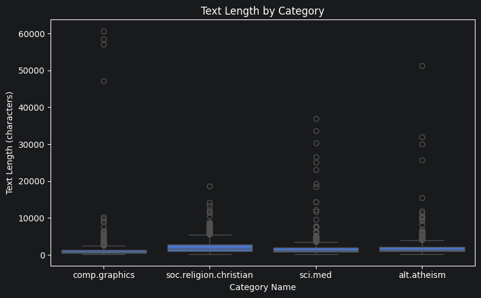
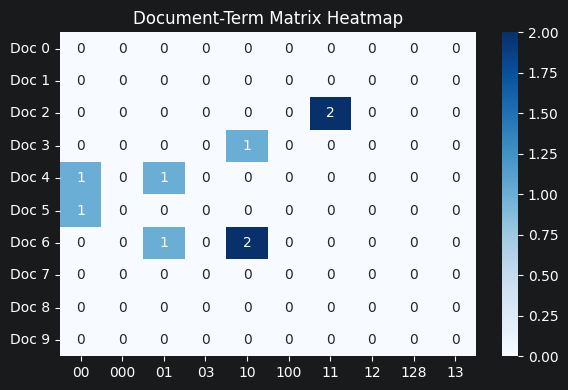
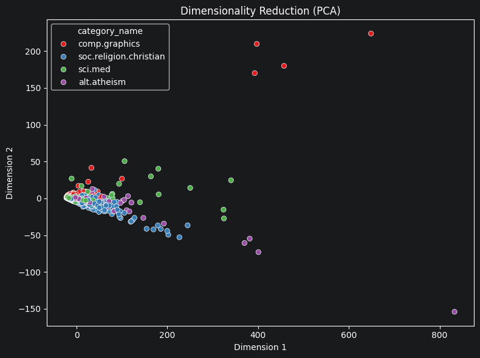
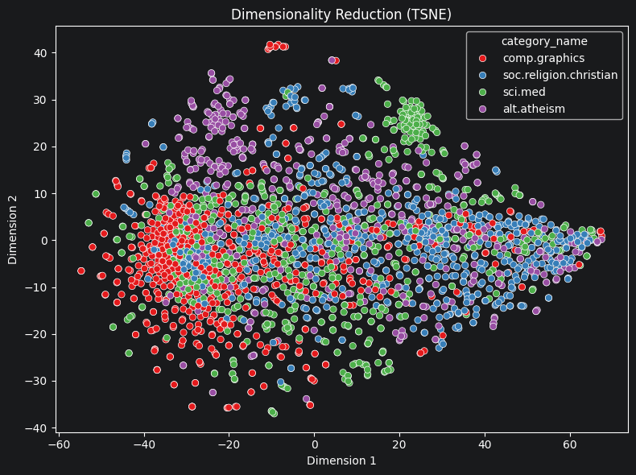
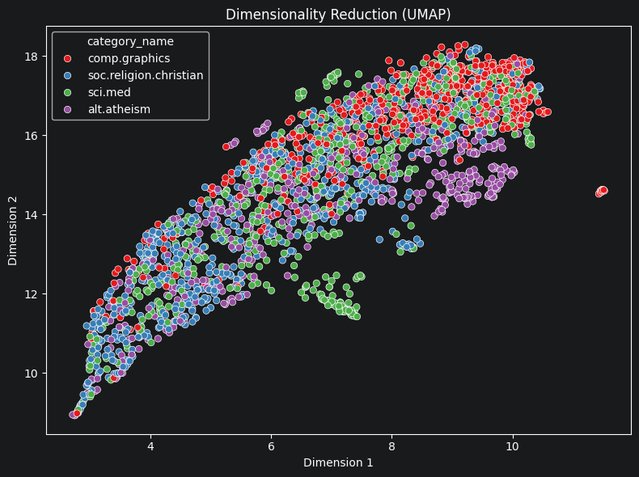
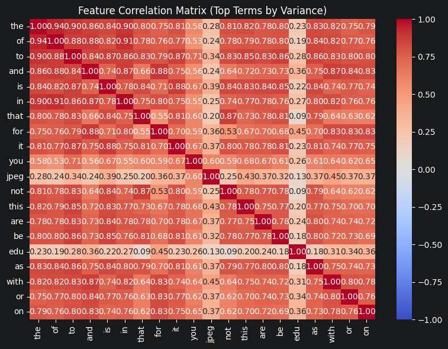

# Your report

First and foremost, I am fortunate to be able to run all the tools I have created
- If you attempt to run a tool at random, you will likely encounter an error specifically, session.dataframe is none => Naturally, the tools must be executed in a specific sequence; you cannot simply run them in an arbitrary order.
- As a first step, we must run load_dataset_tool in first, after we have session.dataframe to run the others tool. When we run tokenize_tool we have 2257 tokenized, and we dont have missing, duplicates, when we run check_missing_tool and check_duplicates_tool. We have been perfect dataframe. And then, we can run sample_data_tool, inspect_data_tool and we dont have anything problem
- The chart shows the text length by Category when we run describe_data_tool for visualize_result_tool.

=> I believe that data loading and the verification of input data are the most critical steps; any errors at this stage can lead to inaccuracies in subsequent data processing steps.

In the second step, if you do not run build_dtm_tool, you will encounter issues where session.feature_matrix or session.feature_names are none. This is an important step for carrying out advanced analysis. Following is mini dtm_heatmap, and after the DTM has been built, we have a sufficient foundation to proceed with the next steps below.

And now, we have created feature_matrix and feature_names. Next, we run reduce_dimensions_tool, feature_correlation_matrix_tool. what we receive: 

A minor oversight on my part is that I have not yet removed the stop words.

=> This is an important step in the data preprocessing phase; dimensionality reduction facilitates data visualization, eliminates redundant data, and increases processing speed. Furthermore, the Feature Correlation Matrix assists in the selection of essential and significant features.

Finally, the tools performed effectively because they followed an established sequence. I believe this is an operational workflow that we should adopt throughout the data exploration process. Adhering to this sequence will ensure accurate outputs, reduce the volume of data requiring processing, and increase processing speed.

In summary, I have been able to build basic tools for data preprocessing. I believe this is an extremely important stage in this course. Through Lab 1, I have reinforced my foundational knowledge and am now capable of performing some of the most essential tasks in the field of data mining.
