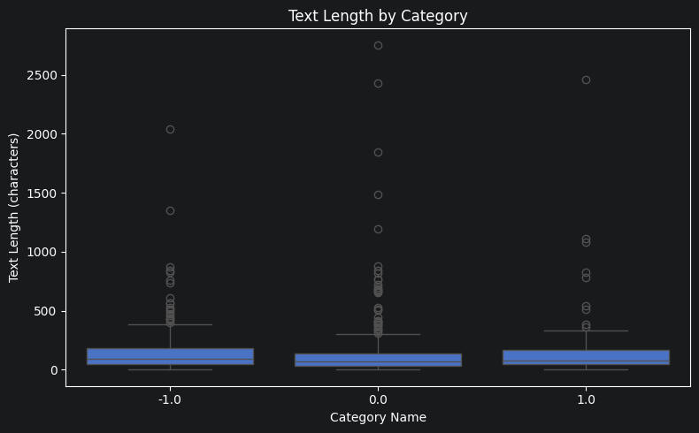
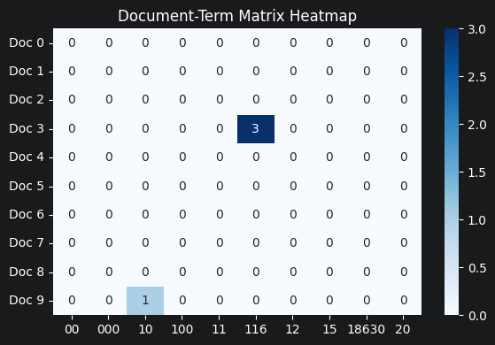
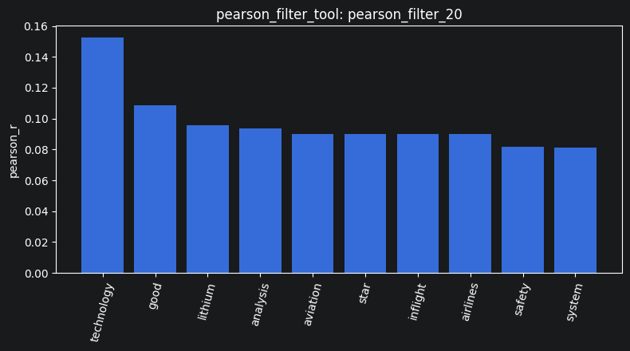
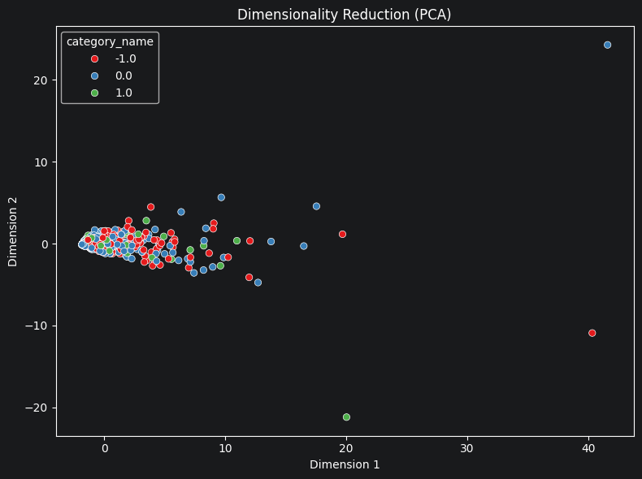
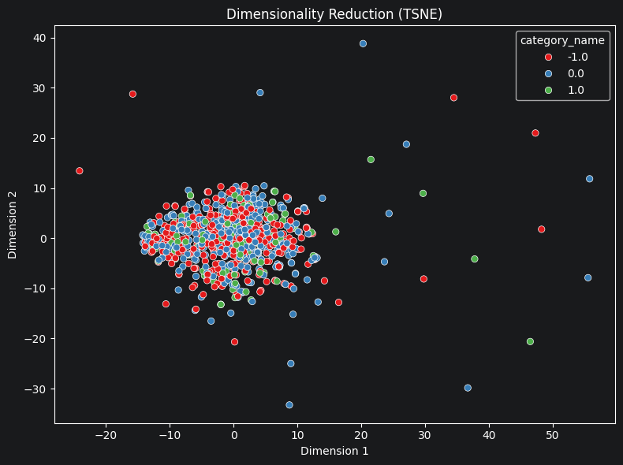
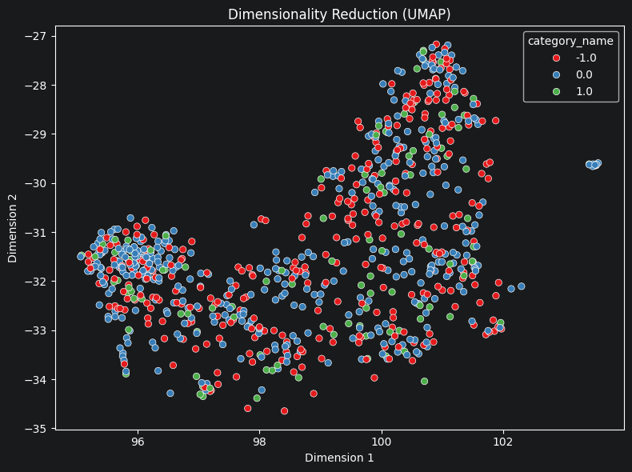

# Your report

The first step - a necessary procedure - is to load the data for use; this task is performed by the `load_dataset_tool`. The initial data loading process has been successfully completed, with `result_id` = `load_dataset_1`. Next, we will check the loaded data for any issues using the tools within tool_data that I have created. Interestingly, we found 34 duplicate documents - you can see this in `check_duplicates_4` - which I subsequently dropped in `check_duplicates_5`. Since these duplicates would not contribute any meaningful analytical value and could potentially introduce noise, I decided to drop them. We are now left with 813 documents; you can verify this in `describe_data_6`. Following bellow, A chart showing the lengths of the documents has been generated; it appears that most entries fall into the "short" category (under 1,000 characters). I consider this to be a relatively small dataset, and I have not identified any issues with it so far.

Now that the data is in good shape, it remains quite difficult to view it easily. Moving on to the next step.
Next step, The most important step I believe I must take to achieve the most perfect data visualization. Now, I will run `build_dtm_tool` with max_features = 1000 and ngram_range = [1,1]. We will get a sparse matrix with 98.4597%. This is a normal matrix, and very good for text processing, the result is `dtm_8`. We can examine the frequency of terms across all documents in `term_frequency_9`; however, the tool I am using does not remove English stopwords, my statistics include a large number of them. Below, you will see the degree of sparseness based on a 10x10 mini-matrix.

Now, We will start by looking at the filters. Since stop words are not removed, using `variance_filter_tool` results in the inclusion of common, meaningless terms; in contrast, `pearson_filter_tool` and `spearman_filter_tool` yield more accurate results. Therefore, for my specific case, `pearson_filter_tool` and `spearman_filter_tool` are the most effective. You can observe the results in `variance_filter_11` (with a threshold of 0.01), ` variance_filter_19` (with a threshold of 0.03), `pearson_filter_13` (using target class 1), and `spearman_filter_14` (also using target class 1). Following bellow, the bar chart pearson filter. Based on this, we can see that Reddit hosts discussions on a wide range of topics, with a strong focus on technology.

Final steps, we move into the crucial phase of data preprocessing. Using the `mine_patterns_tool`, we can identify frequently occurring keywords (as shown in `mine_patterns_5`) to uncover key characteristics and trends. We then apply the `reduce_dimensions_tool` to facilitate the visualization of text clusters, eliminate noise, and address the "curse of dimensionality." Finally, the `binarize_labels_tool` (see `binarize_labels_9`) and the `cosine_similarity_tool` (see `cosine_similarity_10`) further simplify the process of analyzing the data. Below are the dimensionality reduction plots:

In summary, I have successfully managed to get the tools I created for my data preprocessing workflow running smoothly. Based on the theory I have studied and the practical work I have completed, I believe I have been able to build an effective preprocessing tool.
